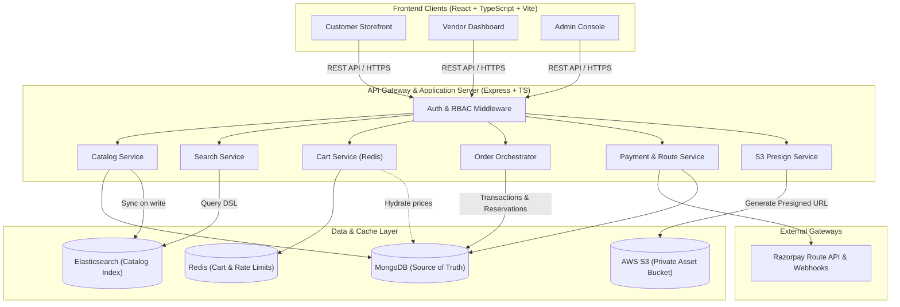

# BadaVyapar — Architecture Specification

> **Domain**: badavyapar.com  
> **Platform**: Multi-Vendor E-Commerce Marketplace  
> **Stack**: React (TypeScript + Vite) · Node.js + Express (TypeScript) · MongoDB · Elasticsearch · Redis · AWS S3 · Razorpay Route  

---

## 1. System Overview

BadaVyapar is a multi-vendor marketplace platform where customers can discover and purchase products from multiple independent sellers in a single, unified checkout. Each vendor independently fulfills their portion of the order, tracks their items, and receives direct automated transfers minus the platform commission.

### Three Primary Roles

1. **Customer**
   - Discover products across categories and sellers.
   - Search with full-text queries, relevance, filters, and sorting.
   - Manage persistent shopping carts.
   - Execute multi-vendor checkouts with single payment.
   - Track per-vendor fulfillment status on multi-item orders.
   - Download itemized PDF invoices based on historical snapshots.
   - Submit verified-purchase reviews.

2. **Vendor / Seller**
   - Apply for selling privileges and provide store profiles.
   - Manage catalog (create, edit, archive products, upload images to S3).
   - View inventory and receive vendor-specific orders (`SellerOrders`).
   - Transition order fulfillment states: `PLACED` → `PACKED` → `SHIPPED` → `DELIVERED`.
   - Monitor earnings, commission deductions, and Razorpay Route transfers.

3. **Admin**
   - Review, approve, or reject vendor applications.
   - Moderate product catalogs and manage global categories.
   - Configure platform commission rates and promotional coupons.
   - Monitor marketplace health, reconcile transfers, and analyze metrics (GMV, platform revenue, vendor volume).

---

## 2. Technology Responsibility Matrix

| Technology | Role & Responsibility | Architectural Invariant |
|---|---|---|
| **React (Vite + TS)** | Customer storefront, vendor portal, and admin management UI | Renders interfaces; never entrusted with pricing or auth rules |
| **Node.js + Express** | REST API gateway, business logic, auth, order orchestration | Sole authority on business invariants and authorization |
| **MongoDB (Mongoose)** | Authoritative system of record for users, products, orders, payments | Single source of truth for financial & inventory states |
| **Elasticsearch** | Search index, full-text tokenization, faceted filters, sorting | Search cache only; prices/stock re-validated against MongoDB |
| **Redis (ioredis)** | Persistent customer cart (7d TTL), token blacklists, rate limits | Low-latency transient state; auto-expiring sessions |
| **AWS S3** | Image and asset storage via short-lived presigned PUT URLs | Private bucket; browser uploads directly without server proxy |
| **Razorpay Route** | Multi-vendor payments, split transfers, linked account payouts | Handled idempotently via webhook events and signatures |
| **JWT (Dual-Token)** | 15-minute access token + 7-day HTTP-only secure refresh cookie | Stateless authentication with revocable session tokens |
| **PDFKit** | Server-side generation of authenticated order invoices | Generated strictly from immutable historical order snapshots |

---

## 3. High-Level System Architecture

---

## 4. Foundational Architectural Rules

### Rule 1: MongoDB is the Ultimate Source of Truth
- Elasticsearch indices and Redis carts are transient/reproducible caches.
- Payment calculations, stock checks, and invoice generation **must always** read authoritative data from MongoDB under transactional locks or conditional writes.
- Client-submitted prices or totals are **never** accepted under any circumstances.

### Rule 2: Backend Owns All Business Rules
- Frontend route guards and disabled buttons are conveniences for user experience.
- The API enforces all RBAC rules, vendor ownership constraints, and status transition state machines.

### Rule 3: Integer Arithmetic (Paise)
- All currency amounts are stored as integer paise (1 INR = 100 paise).
- Floating-point representations for money are prohibited in the schema and calculation layers.

### Rule 4: Historical Snapshots
- Product titles, descriptions, images, prices, and vendor details are snapshotted into `SellerOrder` line items at the moment of checkout.
- Subsequent vendor updates to product records never mutate historical orders or invoices.

### Rule 5: Parent Order + Seller Orders Pattern
- One customer checkout creates exactly one parent `Order` representing the customer's financial transaction.
- It concurrently creates $N$ individual `SellerOrder` records (one per participating vendor).
- Each vendor sees and operates solely upon their own `SellerOrder`.

### Rule 6: Three Mutually Decoupled Statuses
1. **Payment Status**: `PENDING` → `PAID` / `FAILED` / `REFUNDED` (orchestrated by Razorpay webhook)
2. **Fulfillment Status**: `PLACED` → `PACKED` → `SHIPPED` → `DELIVERED` (managed per vendor)
3. **Vendor Transfer Status**: `PENDING` → `PROCESSING` → `TRANSFERRED` / `FAILED` (managed per linked account)

---

## 5. Security & Invariant Enforcement

- **CORS**: Restricted to designated `CLIENT_URL` with credentials allowed.
- **Headers**: Enforced using `helmet`.
- **Authentication**: JWT verification via `authenticate` middleware with role checks (`authorize('VENDOR', 'ADMIN')`).
- **Data Isolation**: Resource ownership middleware guarantees vendor ID matches target entity.
- **Webhooks**: Razorpay signatures verified against the raw request payload before body parsing.
- **S3 Uploads**: Direct uploads via presigned URLs with strict Content-Type and 5MB size limits; credentials never touch client.

