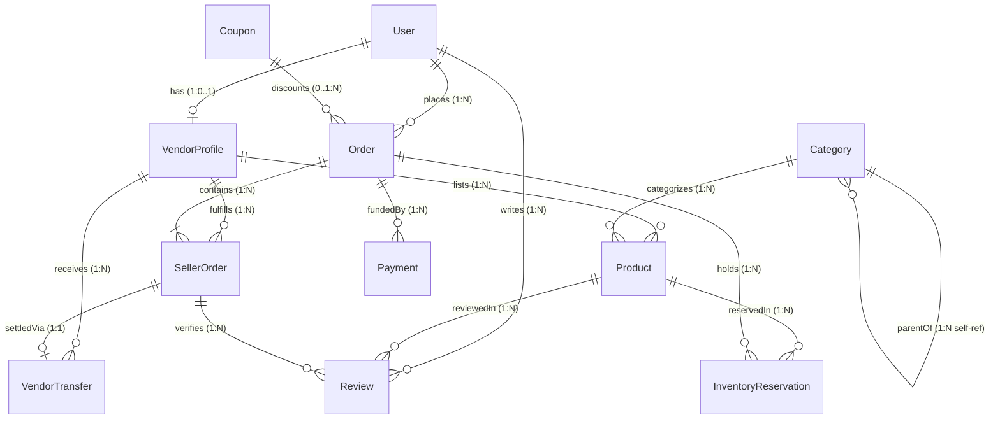

# BadaVyapar — Database Schema Specification

> **Database**: MongoDB (authoritative document store via Mongoose)  
> **Cache & Session**: Redis (ioredis)  
> **Monetary Precision**: All currency values are stored as unsigned 64-bit integer paise (`1 INR = 100 paise`).  

---

## 1. Entity Relationship Overview



---

## 2. MongoDB Collections & Schemas

### 2.1 `users`
Represents all system actors: Customers, Vendors, and Administrators.

```typescript
{
  _id: ObjectId,
  name: { type: String, required: true, trim: true },
  email: { type: String, required: true, unique: true, lowercase: true, index: true },
  passwordHash: { type: String, required: true },
  roles: {
    type: [String],
    enum: ['CUSTOMER', 'VENDOR', 'ADMIN'],
    default: ['CUSTOMER'],
    index: true
  },
  accountStatus: {
    type: String,
    enum: ['ACTIVE', 'SUSPENDED'],
    default: 'ACTIVE'
  },
  createdAt: Date,
  updatedAt: Date
}
```
**Indexes**:
- `{ email: 1 }` (unique)
- `{ roles: 1 }`

---

### 2.2 `vendor_profiles`
Stores approved seller storefront information and linked payout account mappings.

```typescript
{
  _id: ObjectId,
  userId: { type: ObjectId, ref: 'User', required: true, unique: true, index: true },
  storeName: { type: String, required: true, trim: true },
  slug: { type: String, required: true, unique: true, index: true },
  description: { type: String },
  logo: { type: String }, // S3 public URL or key
  contactEmail: { type: String, required: true },
  contactPhone: { type: String, required: true },
  approvalStatus: {
    type: String,
    enum: ['PENDING', 'APPROVED', 'REJECTED'],
    default: 'PENDING',
    index: true
  },
  rejectionReason: { type: String },
  razorpayLinkedAccountId: { type: String }, // Route account ID (acc_xxx)
  createdAt: Date,
  updatedAt: Date
}
```
**Indexes**:
- `{ userId: 1 }` (unique)
- `{ slug: 1 }` (unique)
- `{ approvalStatus: 1 }`

---

### 2.3 `categories`
Hierarchical tree for product categorization.

```typescript
{
  _id: ObjectId,
  name: { type: String, required: true, trim: true },
  slug: { type: String, required: true, unique: true, index: true },
  parentId: { type: ObjectId, ref: 'Category', default: null, index: true },
  isActive: { type: Boolean, default: true, index: true },
  createdAt: Date,
  updatedAt: Date
}
```
**Indexes**:
- `{ slug: 1 }` (unique)
- `{ parentId: 1, isActive: 1 }`

---

### 2.4 `products`
The authoritative product entity.

```typescript
{
  _id: ObjectId,
  vendorId: { type: ObjectId, ref: 'VendorProfile', required: true, index: true },
  categoryId: { type: ObjectId, ref: 'Category', required: true, index: true },
  title: { type: String, required: true, trim: true },
  slug: { type: String, required: true, unique: true, index: true },
  description: { type: String, required: true },
  pricePaise: { type: Number, required: true, min: 0 },
  compareAtPricePaise: { type: Number, min: 0 },
  stock: { type: Number, required: true, min: 0 },
  images: [{
    key: { type: String, required: true },
    url: { type: String, required: true },
    order: { type: Number, default: 0 }
  }],
  status: {
    type: String,
    enum: ['DRAFT', 'PENDING', 'ACTIVE', 'REJECTED', 'ARCHIVED'],
    default: 'DRAFT',
    index: true
  },
  ratingSummary: {
    average: { type: Number, default: 0, min: 0, max: 5 },
    count: { type: Number, default: 0, min: 0 }
  },
  tags: [{ type: String, index: true }],
  createdAt: Date,
  updatedAt: Date
}
```
**Indexes**:
- `{ slug: 1 }` (unique)
- `{ vendorId: 1, status: 1 }`
- `{ categoryId: 1, status: 1 }`
- `{ status: 1, createdAt: -1 }`

---

### 2.5 `orders` (Parent Order)
Represents the customer checkout session and aggregate financial totals.

```typescript
{
  _id: ObjectId,
  orderNumber: { type: String, required: true, unique: true, index: true },
  customerId: { type: ObjectId, ref: 'User', required: true, index: true },
  addressSnapshot: {
    name: { type: String, required: true },
    line1: { type: String, required: true },
    line2: { type: String },
    city: { type: String, required: true },
    state: { type: String, required: true },
    pincode: { type: String, required: true },
    phone: { type: String, required: true }
  },
  itemSubtotalPaise: { type: Number, required: true },
  discountPaise: { type: Number, default: 0 },
  shippingPaise: { type: Number, default: 0 },
  taxPaise: { type: Number, default: 0 },
  totalPaise: { type: Number, required: true },
  couponId: { type: ObjectId, ref: 'Coupon', default: null },
  couponSnapshot: {
    code: String,
    discountType: String,
    discountValue: Number
  },
  paymentStatus: {
    type: String,
    enum: ['PENDING', 'PAID', 'FAILED', 'REFUNDED'],
    default: 'PENDING',
    index: true
  },
  razorpayOrderId: { type: String, index: true },
  razorpayPaymentId: { type: String, index: true },
  createdAt: Date,
  updatedAt: Date
}
```
**Indexes**:
- `{ orderNumber: 1 }` (unique)
- `{ customerId: 1, createdAt: -1 }`
- `{ paymentStatus: 1 }`
- `{ razorpayOrderId: 1 }`

---

### 2.6 `seller_orders` (Sub-Orders per Vendor)
Decoupled vendor sub-order containing immutable item snapshots and fulfillment state.

```typescript
{
  _id: ObjectId,
  orderId: { type: ObjectId, ref: 'Order', required: true, index: true },
  vendorId: { type: ObjectId, ref: 'VendorProfile', required: true, index: true },
  items: [{
    productId: { type: ObjectId, ref: 'Product', required: true },
    productSnapshot: {
      title: { type: String, required: true },
      pricePaise: { type: Number, required: true },
      image: { type: String }
    },
    quantity: { type: Number, required: true, min: 1 },
    lineTotalPaise: { type: Number, required: true }
  }],
  vendorSubtotalPaise: { type: Number, required: true },
  commissionRate: { type: Number, required: true }, // Snapshot e.g. 0.10
  commissionPaise: { type: Number, required: true },
  vendorNetPaise: { type: Number, required: true },
  fulfillmentStatus: {
    type: String,
    enum: ['PLACED', 'PACKED', 'SHIPPED', 'DELIVERED', 'CANCELLED'],
    default: 'PLACED',
    index: true
  },
  trackingNumber: { type: String },
  trackingUrl: { type: String },
  transferStatus: {
    type: String,
    enum: ['PENDING', 'PROCESSING', 'TRANSFERRED', 'FAILED'],
    default: 'PENDING',
    index: true
  },
  razorpayTransferId: { type: String },
  createdAt: Date,
  updatedAt: Date
}
```
**Indexes**:
- `{ orderId: 1, vendorId: 1 }` (unique)
- `{ vendorId: 1, fulfillmentStatus: 1, createdAt: -1 }`
- `{ transferStatus: 1 }`

---

### 2.7 `payments`
Tracks raw gateway interactions, signatures, and processed webhook events.

```typescript
{
  _id: ObjectId,
  orderId: { type: ObjectId, ref: 'Order', required: true, index: true },
  razorpayOrderId: { type: String, required: true, index: true },
  razorpayPaymentId: { type: String, index: true },
  razorpaySignature: { type: String },
  amountPaise: { type: Number, required: true },
  currency: { type: String, default: 'INR' },
  status: {
    type: String,
    enum: ['CREATED', 'CAPTURED', 'FAILED', 'REFUNDED'],
    default: 'CREATED'
  },
  webhookEvents: [{
    eventId: { type: String, required: true },
    event: { type: String, required: true },
    receivedAt: { type: Date, default: Date.now }
  }],
  createdAt: Date,
  updatedAt: Date
}
```

---

### 2.8 `inventory_reservations`
Temporary stock holds for active checkout sessions, released upon expiration or failure.

```typescript
{
  _id: ObjectId,
  orderId: { type: ObjectId, ref: 'Order', required: true, index: true },
  productId: { type: ObjectId, ref: 'Product', required: true, index: true },
  quantity: { type: Number, required: true, min: 1 },
  status: {
    type: String,
    enum: ['HELD', 'CONFIRMED', 'RELEASED'],
    default: 'HELD',
    index: true
  },
  expiresAt: { type: Date, required: true, index: true },
  createdAt: Date
}
```

---

### 2.9 `coupons`
Promotional rules and usage limits.

```typescript
{
  _id: ObjectId,
  code: { type: String, required: true, unique: true, uppercase: true, index: true },
  type: { type: String, enum: ['PERCENTAGE', 'FIXED'], required: true },
  valuePaise: { type: Number },     // for FIXED
  percentage: { type: Number },     // for PERCENTAGE (e.g. 15 for 15%)
  minOrderPaise: { type: Number, default: 0 },
  maxDiscountPaise: { type: Number },
  usageLimit: { type: Number, default: 100 },
  usedCount: { type: Number, default: 0 },
  validFrom: { type: Date, required: true },
  validUntil: { type: Date, required: true },
  isActive: { type: Boolean, default: true, index: true },
  createdAt: Date
}
```

---

### 2.10 `reviews`
Verified buyer feedback linked to purchased products.

```typescript
{
  _id: ObjectId,
  productId: { type: ObjectId, ref: 'Product', required: true, index: true },
  customerId: { type: ObjectId, ref: 'User', required: true, index: true },
  orderId: { type: ObjectId, ref: 'Order', required: true },
  sellerOrderId: { type: ObjectId, ref: 'SellerOrder', required: true },
  rating: { type: Number, required: true, min: 1, max: 5 },
  title: { type: String, required: true },
  comment: { type: String, required: true },
  isVerifiedPurchase: { type: Boolean, default: true },
  createdAt: Date
}
```
**Indexes**:
- `{ productId: 1, createdAt: -1 }`
- `{ customerId: 1, productId: 1 }` (unique constraint: 1 review per purchase)

---

## 3. Redis Key Structures

| Purpose | Key Format | Value Type | TTL |
|---|---|---|---|
| **Shopping Cart** | `cart:v1:<customerId>` | JSON `{ items: [{ productId, quantity }], updatedAt }` | 7 Days (`604800s`) |
| **Token Blacklist** | `bl:<jti>` | String `"revoked"` | Matching JWT expiration |
| **Rate Limiter** | `rl:auth:<ip>` | String (Integer count) | 60 Seconds |
